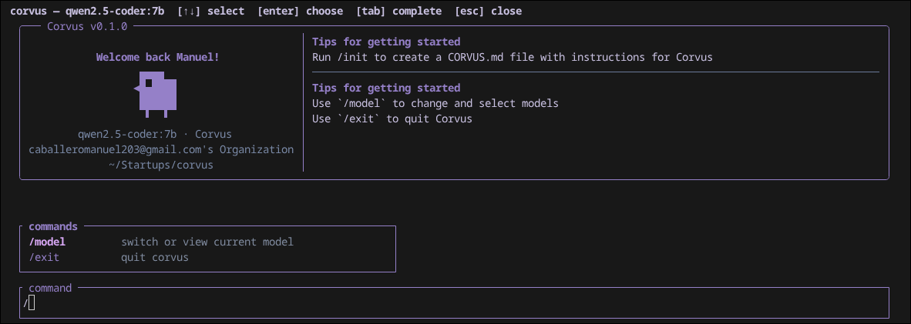

# Corvus

A terminal-native AI coding assistant written in Rust. Corvus runs entirely against local [Ollama](https://ollama.ai/) models and ships a Ratatui-based TUI for interactive, agentic coding sessions.



## Features

- **Local-first**: All inference runs through Ollama on your machine. No external API calls.
- **Agentic loop**: Generates, proposes, and selectively executes shell commands and scripts.
- **Dynamic skill injection**: Resolves and injects context only when a turn requires it, keeping prompts lean.
- **Zero-shot tool routing**: Selects tools per turn without hard-coded heuristics.
- **Thought toggle**: `Ctrl+T` shows or hides the model's `<think>` traces.
- **Ratatui interface**: Command palette, keyboard navigation, syntax highlighting, and a transparent-friendly color scheme.

## Installation

Requires [Rust](https://rustup.rs/) and [Ollama](https://ollama.ai/).

```bash
ollama pull qwen2.5-coder:7b
cargo build --release
cargo run --release -- -m "qwen2.5-coder:7b"
```

## Keyboard Shortcuts

| Shortcut  | Action                                  |
|-----------|-----------------------------------------|
| `Ctrl+C`  | Quit                                    |
| `Ctrl+T`  | Toggle thought-process display          |
| `/`       | Open command palette                    |
| `↑` / `↓` | Scroll history or palette               |
| `Enter`   | Send message or confirm selection       |
| `Tab`     | Autocomplete                            |
| `Esc`     | Close palette                           |

## Architecture

| File              | Responsibility                                        |
|-------------------|-------------------------------------------------------|
| `src/agent.rs`    | Turn orchestration and tool selection                 |
| `src/executor.rs` | Sandboxed script execution and output capture        |
| `src/ollama.rs`   | Ollama daemon client                                  |
| `src/skills.rs`   | Context-aware skill injection                         |
| `src/prompt.rs`   | System prompt and behavioral directives               |
| `src/tui.rs`      | Ratatui event loop and rendering                      |

Built on `tokio`, `reqwest`, `ratatui`, and `crossterm`.

## Project links

- [Corvus project overview](https://manuelcaballero.dev/projects/corvus-agent)
- [Manuel Caballero — Full-Stack AI Engineer](https://manuelcaballero.dev)

## License

MIT.
